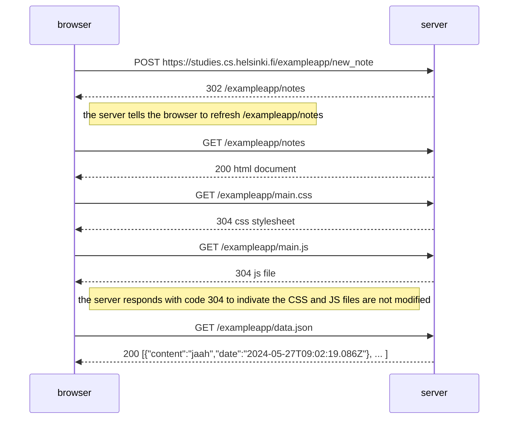

```
8c0d0409030a82ba97cf1eb17315ffd29c01a6f5133384c2d32bc7cd1fe9
3d184ab774cfab12341e28b4c12ed8143ee328f731e99cba72da6a5b0e82
746b32b0b19fcc827434245e58c9ea45e3c5e1ffd376467f91721017d972
b56e0e5383bd4ca48d4407ce117dbdf7caed3d9c4e5939104f922c98772c
4dc47490feb1bbf02d67ec1789ac707ac1489417ec89cd68d741c1bb12fa
07f07245f8ea06aaa56b01f95f973bbb62c247f9e37bd0
```
